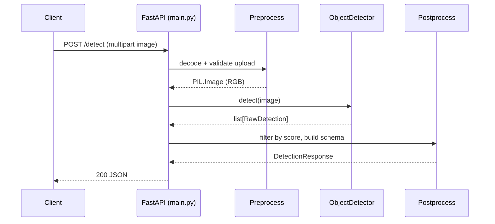

# vision-detect-service

A small, production-shaped FastAPI microservice that performs object detection
on uploaded images using a pretrained [torchvision](https://pytorch.org/vision/stable/models.html#object-detection)
model (COCO classes). Built as a portfolio piece to demonstrate a realistic
computer-vision serving pattern: a thin HTTP layer, an injectable model
backend, a typed response contract, and a test suite that doesn't require a
GPU or a weight download to run.

## Motivation

"Wrap a pretrained CV model in an API" is a common first step for real
production systems (content moderation, retail shelf analysis, surveillance
triage, robotics perception, etc.). This repo focuses on doing that *well*:

- The model is **injectable**, not hardwired into the route handlers, so the
  HTTP contract (validation, status codes, response schema) can be tested
  fast and deterministically, independent of the neural network.
- Dependencies are kept deliberately light: `torchvision`'s built-in detection
  models (`fasterrcnn_mobilenet_v3_large_320_fpn` by default) instead of
  `ultralytics`/YOLO, avoiding extra license terms and bespoke weight
  downloads -- torchvision fetches official, COCO-pretrained weights from
  PyTorch's own CDN on first use.
- Zero licensing ambiguity in the repo: the bundled sample images are
  generated from scratch with PIL (flat shapes, text, noise) -- no stock
  photos, no scraped images.

## Architecture

```
                         POST /detect
                         POST /detect/visualize
                               |
                               v
                       +---------------+
                       |   FastAPI     |
                       |   (main.py)   |
                       +---------------+
                               |
                   1. PREPROCESS (_load_image)
                      - validate content-type
                      - decode bytes -> PIL.Image
                      - convert to RGB
                               |
                               v
                   2. MODEL (ObjectDetector.detect)
                      +-------------------------+
                      | TorchvisionDetector      |  <-- real model
                      |  fasterrcnn_mobilenet_v3 |      (COCO-pretrained,
                      |  _large_320_fpn (COCO)   |       downloaded on first
                      +-------------------------+       use by torchvision)
                      | StubDetector              |  <-- deterministic,
                      |  (tests / CI)             |      dependency-free
                      +-------------------------+
                               |
                               v
                   3. POSTPROCESS
                      - drop detections below score_threshold
                      - map torchvision tensors -> RawDetection
                      - RawDetection -> Detection/DetectionResponse (pydantic)
                               |
                               v
                   4. RESPONSE
                      - /detect            -> JSON (DetectionResponse)
                      - /detect/visualize  -> PNG (boxes drawn with PIL)
```

Request flow as a sequence:



The same pipeline backs `/detect/visualize`, except the postprocess step
draws boxes/labels onto the image (`visualize.py`) and the response is a PNG
instead of JSON.

## Project structure

```
vision-detect-service/
├── src/vision_detect_service/
│   ├── __init__.py
│   ├── config.py          # env-driven settings (model name, score threshold, device)
│   ├── detector.py        # ObjectDetector protocol, TorchvisionDetector, StubDetector
│   ├── main.py             # FastAPI app: /health, /detect, /detect/visualize
│   ├── schemas.py          # pydantic request/response models
│   └── visualize.py        # bounding-box drawing + PNG encoding
├── tests/
│   ├── fixtures/
│   │   ├── generate_fixtures.py   # regenerates the synthetic PNGs below
│   │   ├── shapes.png
│   │   ├── text_and_shapes.png
│   │   └── noise.png
│   ├── conftest.py
│   ├── test_detect_endpoint.py        # request validation, API contract
│   ├── test_visualize.py              # bbox-drawing logic + /detect/visualize
│   ├── test_schemas.py                # pydantic schema edge cases
│   └── test_integration_real_model.py # @pytest.mark.integration, real model
├── app_streamlit.py        # optional local demo UI
├── Dockerfile
├── pyproject.toml
├── requirements.txt
├── .github/workflows/ci.yml
└── LICENSE
```

## Setup

Requires Python 3.10+.

```bash
python -m venv .venv
source .venv/bin/activate        # Windows: .venv\Scripts\activate

pip install -r requirements.txt
pip install -e ".[dev]"          # adds pytest, ruff, httpx for testing
```

**Windows note:** `torch`/`torchvision` are pinned to the `2.2.x`/`0.17.x`
line (see the comment in `pyproject.toml`). This was found by direct
testing: newer torch wheels on a Windows machine with an outdated Visual
C++ Redistributable fail to import with `OSError: [WinError 1114]`
(`msvcp140.dll` access violation on load) unless the redistributable is
updated to a current build -- something that requires admin rights and
isn't always available. torch 2.2.x works against the VC++ runtime that
ships by default on most Windows installs. If you hit that error anyway,
either install the [latest VC++ Redistributable](https://aka.ms/vs/17/release/vc_redist.x64.exe)
(requires admin) or stay on this pinned range.

### Run the API

```bash
uvicorn vision_detect_service.main:app --reload --port 8000
```

**First-run note:** the first request that builds the detector downloads the
pretrained weights via torchvision (cached under `~/.cache/torch/hub/checkpoints`,
roughly 75 MB for the default model). This requires network access once;
every run after that is fully offline. You can switch to the smaller
`ssdlite320_mobilenet_v3_large` model (~13 MB) by setting
`VISION_MODEL_NAME=ssdlite320_mobilenet_v3_large`.

### Example request

```bash
curl -X POST http://localhost:8000/detect \
  -F "file=@tests/fixtures/shapes.png"
```

Example response, captured from an actual run of the real model against
`tests/fixtures/text_and_shapes.png` with `VISION_SCORE_THRESHOLD=0.3` (see
"Exercising the real model locally" below for how this was produced):

```json
{
  "detections": [
    {
      "label": "stop sign",
      "confidence": 0.4751032292842865,
      "box": {
        "x_min": 258.6072692871094,
        "y_min": 86.57657623291016,
        "x_max": 423.9376525878906,
        "y_max": 232.63479614257812
      }
    }
  ],
  "image_width": 480,
  "image_height": 320,
  "model_name": "fasterrcnn_mobilenet_v3_large_320_fpn"
}
```

For the annotated-image demo endpoint:

```bash
curl -X POST http://localhost:8000/detect/visualize \
  -F "file=@tests/fixtures/shapes.png" \
  -o annotated.png
```

### Run the Streamlit demo

With the API running in one terminal:

```bash
pip install -e ".[demo]"
streamlit run app_streamlit.py
```

Upload an image (or reuse one of the files in `tests/fixtures/`) to see the
annotated detection result side-by-side with the raw JSON response.

## Testing

```bash
pytest -q
```

This runs the full suite **against a deterministic `StubDetector`**, not the
real neural network -- no torch forward pass, no network access, sub-second
runtime. It covers request validation (missing/empty/non-image uploads),
the `DetectionResponse`/`BoundingBox` schema contract, and the bounding-box
drawing logic in `visualize.py`.

A second, explicitly marked test module exercises the real pretrained model:

```bash
pytest -m integration -q
```

### Why the real model is excluded from the default test run

Downloading ~75 MB of pretrained weights from a third-party CDN inside CI is
a flaky, slow thing to depend on for a PR gate -- a transient network hiccup
should never block merging a one-line docstring fix. So:

- `ObjectDetector` is a small protocol; FastAPI's dependency-injection system
  (`Depends(get_detector)`) lets tests swap in `StubDetector` via
  `app.dependency_overrides`, with zero changes to route code.
- The default test run (`pytest -q`, and the `ci.yml` workflow) only ever
  imports `vision_detect_service.detector.StubDetector`, so running them
  never imports `torch`/`torchvision` at all for those cases.
- `tests/test_integration_real_model.py` is tagged
  `pytestmark = pytest.mark.integration`, and `pyproject.toml` sets
  `addopts = "-m 'not integration'"`, so that module is skipped unless you
  explicitly ask for it with `-m integration`. It's intended to be run
  locally (or in an opt-in, non-blocking CI job) when you want to verify the
  real model end to end.

### Exercising the real model locally

Run once with network access available:

```bash
pytest -m integration -q
```

This was actually run against this repository, end to end, on a fresh
virtual environment: the first call to `TorchvisionDetector()` downloaded
`fasterrcnn_mobilenet_v3_large_320_fpn-907ea3f9.pth` (~75 MB) from
`download.pytorch.org` into `~/.cache/torch/hub/checkpoints/`, built the
model, and ran a real forward pass. Two results from that run, captured
verbatim:

On `tests/fixtures/shapes.png` (flat-color rectangles/ellipse/triangle, 640x480)
with `score_threshold=0.3` -- no confident COCO-class match, which is the
expected, sensible outcome for a model trained on natural photographs:

```
>>> detector.detect(image)
[]
```

On `tests/fixtures/text_and_shapes.png` (a pink ellipse and a teal rounded
rectangle on a dark background, 480x320) the model *does* pick something up
-- a plausible, if low-confidence, real detection on a synthetic image:

```
>>> detector.detect(image)
[RawDetection(label='stop sign', confidence=0.4751032292842865,
              box=(258.607, 86.577, 423.938, 232.635))]
```

(The pink ellipse is apparently "stop sign"-ish enough in color/shape to
clear a 0.3 confidence threshold -- a nice illustration of both the model
genuinely running inference, and why a flat synthetic image is not a
reliable detection benchmark.)

The important things this verifies: the weight download/caching works, the
preprocessing transform (`weights.transforms()`) matches the model's
expected input, the forward pass completes without error, and the output
tensors decode into well-formed `RawDetection` objects. See
`tests/test_integration_real_model.py` for the equivalent assertions as a
test, and run `ruff check .` / `pytest -q` as shown above to reproduce the
rest of the verification.

## Linting

```bash
ruff check .
```

## Docker

```bash
docker build -t vision-detect-service .
docker run -p 8000:8000 vision-detect-service
```

The image installs CPU-only PyTorch wheels and does **not** bundle model
weights; the first request after a fresh container start downloads them (see
the first-run note above).

## Configuration

| Environment variable | Default | Description |
|---|---|---|
| `VISION_MODEL_NAME` | `fasterrcnn_mobilenet_v3_large_320_fpn` | `fasterrcnn_mobilenet_v3_large_320_fpn` or `ssdlite320_mobilenet_v3_large` |
| `VISION_SCORE_THRESHOLD` | `0.5` | Minimum confidence to include a detection |
| `VISION_DEVICE` | `cpu` | torch device string (`cpu`, `cuda`, ...) |

## Scope / deliberate cuts

- No auth, rate limiting, or request size limits -- out of scope for a
  portfolio demo of the detection pipeline itself.
- No batch/multi-image endpoint -- one image per request keeps the contract
  simple to read and test.
- No GPU-specific tuning or ONNX/TensorRT export -- `VISION_DEVICE=cuda` works
  if a CUDA build of torch is installed, but performance tuning is out of
  scope.

## License

MIT License, Copyright (c) 2026 Samir Rafigzada. See [LICENSE](LICENSE).
